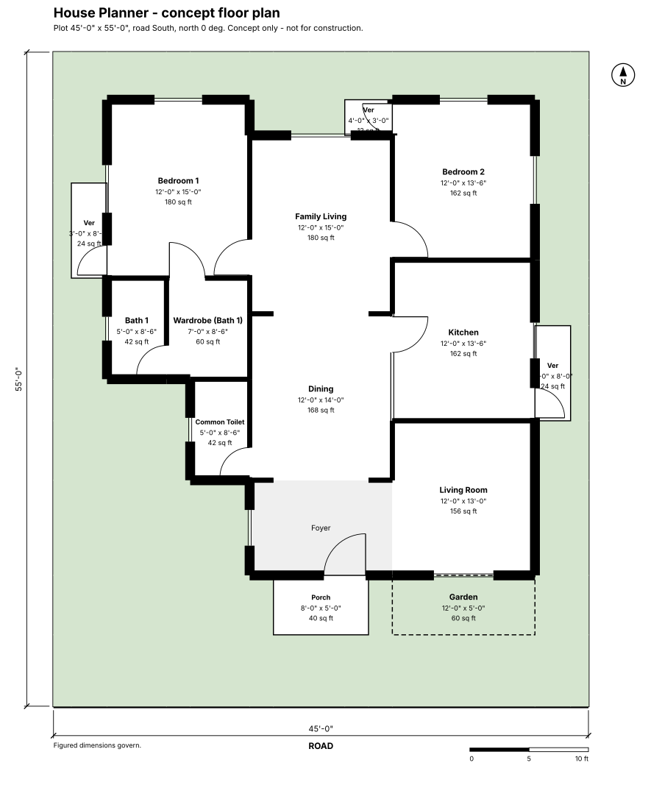
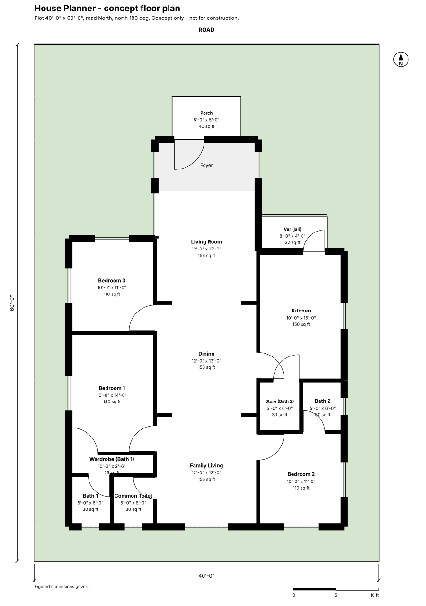
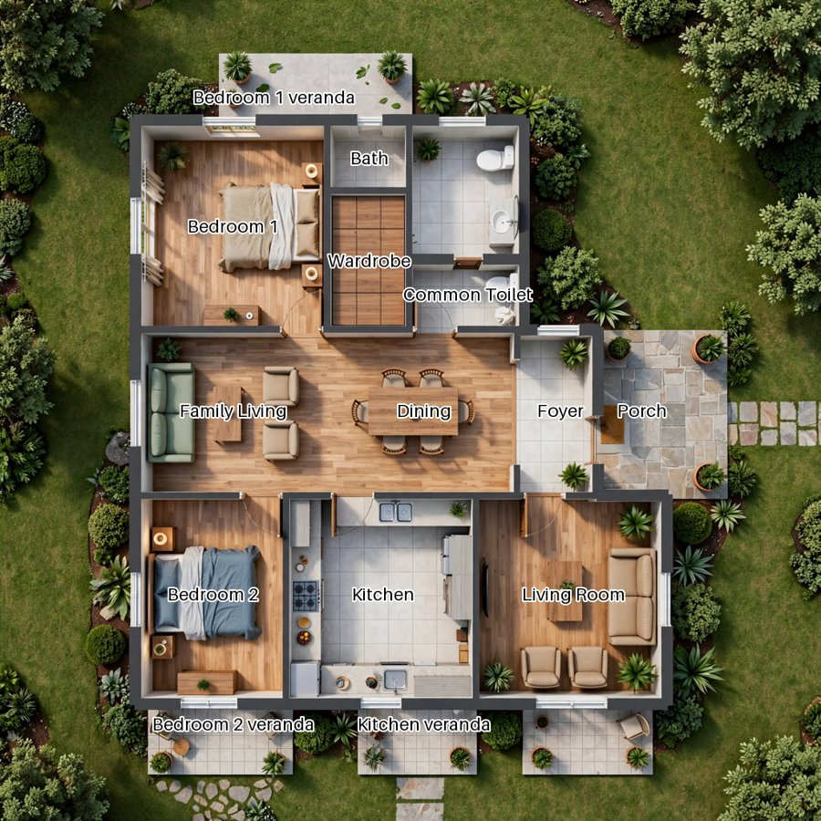
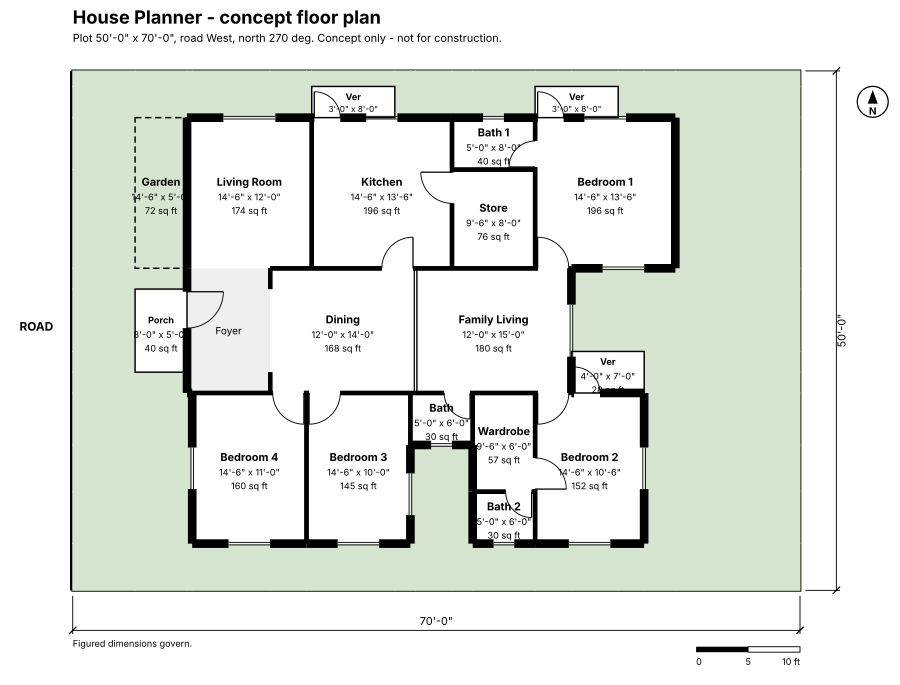

# House Planner

**Concept floor plans in seconds.**

House Planner turns a plot and a family's needs into three ready-to-review single-storey floor plans, each with walls, doors and windows, plain-language reasons, a colored render and a layered DXF file for CAD.



## What it does

1. **Describe the plot:** road frontage, depth from the road, and which way north is.
2. **Describe the family:** number of bedrooms and toilets, plus any wishes, typed or spoken ("parents live with us, we want a big dining area").
3. **Get three different layouts** in seconds, drawn to scale with real walls, doors and windows.
4. **Read why each plan works**, in plain language, with anything worth a second look flagged.
5. **Render a plan** into a realistic top-down presentation image, or **download a layered DXF** that opens straight in CAD.

## Why it matters

When an architect starts designing a new home, working out the layout and drawing it up in CAD usually takes weeks. Clients, meanwhile, often can't picture a floor plan or explain what they want.

- **Architects** get a sound starting layout and a CAD file on every project, so they spend their time on design instead of first drafts.
- **Clients** get a picture to react to, which makes the first conversation much easier.

## Meta models used

Every AI call the app makes at runtime goes to a Meta model.

| Meta model | What it does in the app | File |
| --- | --- | --- |
| **Muse Spark** | Reads the brief and writes the room program: every room, its size and what it should sit next to, plus a short design explanation. | `ai_program.py` |
| **Muse Spark** (vision) | Checks each render against the original plan, room by room: same layout, walls and doors, and the right furniture in each room. Its findings are sent back to Muse Image as corrections. | `plan_render.py` |
| **Muse Image** | Turns the plan drawing into a realistic top-down render, and re-renders using Muse Spark's corrections when the check finds problems. | `plan_render.py` |
| **Muse Voice Transcribe** | Turns the family's spoken brief into text. | `voice.py` |

The app shows these calls live in an **AI activity** card, with each model, task and duration (`ai_activity.py`). Only metadata is recorded, never prompts, replies or keys.

## Built with Muse Code

I built House Planner with **Muse Code** during the hackathon (Oct 26 to Nov 4, 2026): Muse Code wrote the code under my direction, with a few small manual edits. `PROJECT.md` is the project memory Muse Code read at the start of every session.

## How it works

```
Brief (typed or spoken)
  -> Muse Voice Transcribe (if spoken)
  -> Muse Spark: room program (rooms, sizes, adjacencies)
  -> Layout engine: typologies, room sizes, adjacency, doors and windows
  -> Three options + plain-language checks ("Why this plan works")
  -> Optional: Muse Image render -> Muse Spark check -> corrected re-render
  -> Layered DXF export
```

- **Layout engine** (`layout.py`, `typology.py`, `openings.py`): places rooms using house typologies (open living spine, bedrooms and wet areas on outer walls), fits them to the plot and road side, and adds doors and windows.
- **Drawing and export** (`draw.py`, `dxf_export.py`): the plan drawing on screen, and a DXF in inches with separate layers for walls, doors, windows, labels, verandas and landscape.
- **Stress tested** (`stress_grid.py`): 560 plot and family combinations ran through the full app path with no crashes. Plots that can't fit the brief get a friendly message instead of a broken plan.

| Plan | Render |
| --- | --- |
|  |  |

## Run it locally

You need **Python 3.13** and a Meta Model API key.

```bash
git clone https://github.com/ndipto/house-planner.git
cd house-planner
python -m venv .venv
# Windows: .venv\Scripts\activate    macOS/Linux: source .venv/bin/activate
pip install -r requirements.txt
```

Copy `.env.example` to `.env` and put your key in it:

```
META_API_KEY=your-key-here
```

`.env` is git-ignored. Never commit your key.

Start the app:

```bash
streamlit run app.py
```

Then click **Start planning**, press **Try an example**, and click **Generate plans**.

### Tests

```bash
python test_layout.py       # layout engine, checks and drawing
python test_plan_render.py  # render and render-check flow (mocked)
python test_render.py       # Muse Image calls (mocked)
python test_voice.py        # voice brief (mocked)
python test_dxf.py          # DXF export
python test_ai_activity.py  # AI activity log
```

Two layout tests are known to fail on edge cases and are documented in `NIGHT_REPORT.md`.

## Built during the hackathon

| Date | Milestone |
| --- | --- |
| Oct 29 | Project spec and design rules; brief to room program with Muse Spark |
| Oct 29-30 | Layout engine, plan drawing, three typology options, walls, doors and windows |
| Oct 30-31 | Design review rounds turned into layout rules; regression tests |
| Oct 31 | Muse Image renders with automatic checks; voice brief with Muse Voice Transcribe |
| Nov 1 | Client-friendly wording, faithful render path, layered DXF export |
| Nov 2 | Stress test across 560 briefs; full interface redesign |
| Nov 3 | AI activity card, image download, render check that compares layout with the plan and sends corrections, mobile layout |

The full history is in the git log.



## Current scope

Built in one week, House Planner covers **single-storey houses in Bangladesh only**. Duplexes, apartments and commercial buildings are not supported.

## Disclaimer

House Planner produces **concept plans only**. They are not for construction. AI renders are experimental and may not match the plan exactly; the floor plan is the reliable drawing.

## License

See `LICENSE`.
